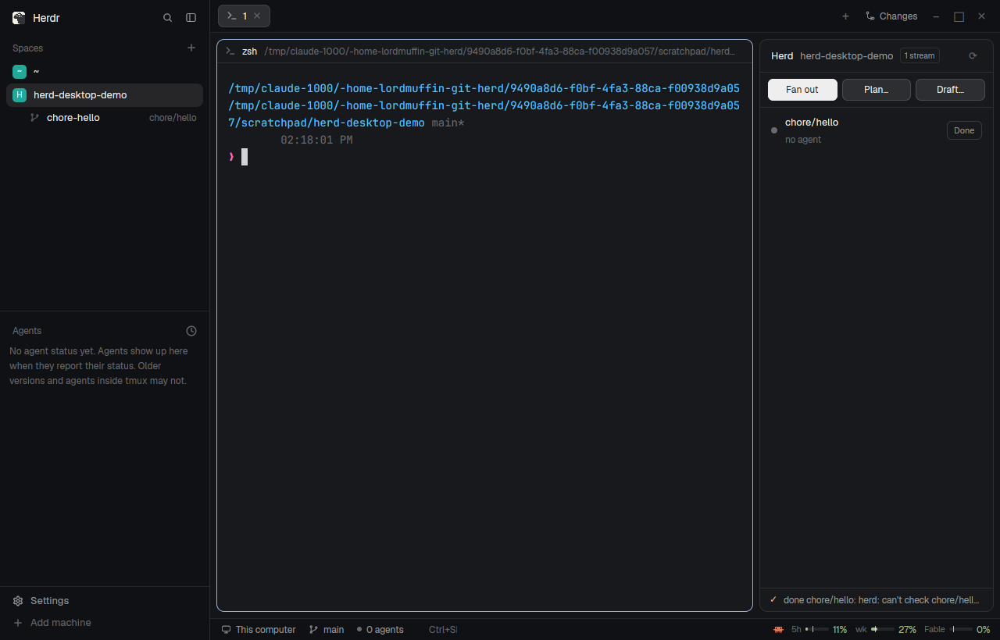

# Herd

A right-hand panel for [herd](../README.md), which fans coding agents out into git worktrees. It
shows the herd streams of the repo you are working in. Each stream is one branch with its own
worktree, space and agent, and the panel shows each one's live agent status and plan stage. Its
buttons start herd's fan-out, plan and draft, and finish a stream with herd done. All the work is
done by `bin/herd`, which the panel runs. The panel only shows and asks.

## What you see

The panel is a card that fills its block. It has a 10px radius, a 1px `border` line and a
`background` fill, like the shipped Files and Changes panels. From top to bottom:

- **Header**, 42px tall with a bottom border. It holds "Herd" in semibold 13px, the repo's name in
  `muted`, and a chip counting the streams ("1 stream": 10px text with a 1px border and a 4px
  radius). A ⟳ button sits at the right edge. While a status refresh runs, the ⟳ becomes a
  braille spinner.
- **Actions**, a row with 10px/8px padding and a bottom border. It holds three buttons of equal
  width, 28px tall with a 7px radius:
  - **Fan out**, the primary button (`solid` fill with `solid_foreground` text).
  - **Plan…** and **Draft…**, filled `raised` with an `input` border.
- **Streams**, a scrolling list. Each row is 46px tall with a 7px radius and holds:
  - an 8px status dot;
  - the branch name;
  - a second line in 11.5px `dim` text: the plan stage ("stage 2/4 running", "complete") if the
    stream is a plan, then the agent's status ("working", "no agent", "no space open");
  - a small **Done** button at the right, 24px tall.

  Rows that need you come first (blocked, then done, then working, then idle), then the rest by
  branch name. The row of the space on screen has a `selected` background.
- **Footer**, 30px tall with a top border. It appears once herd has run something. While a job
  runs, it shows a spinner and the job's name. Afterwards it shows ✓ or ✗ and the job's last line
  of output.

With no streams, the list says how to start one. Outside a git repo, it asks you to focus a
terminal in one.

## How it behaves

- **Status dot.** The colour follows the agent: `working` (the dot pulses in opacity, 0.35 to 1,
  every 1.2s), `blocked` (the detail line turns `blocked` too), `done` or `idle`. With no agent,
  the dot is `dim`. The status comes live from the app's `agents()`, matched to the stream by the
  space id that `herd status -j` reports. The panel re-reads `herd status -j` every 6s, and on ⟳,
  for new streams and plan stages.
- **Which repo.** The panel follows the focused terminal's folder (`focused().cwd`, else the shown
  space's first terminal). It maps that folder to the main checkout through
  `git rev-parse --git-common-dir`, so a stream's own space shows the same list as its repo.
- **Clicking a row** selects that stream's space (`space.select`).
- **Done** opens the shipped `confirm` dialog. Confirm runs `herd done <branch>`, which checks
  that the PR is merged, the agent idle and the tree clean, then removes the worktree, space and
  branches.
- **Fan out** lists `Tasks*.herd` in the repo root:
  - none: a toast offers Draft;
  - one: it is used;
  - several: herd's picker dialog asks which.

  The shipped `confirm` dialog then shows `herd -n -f <file>` (each task's branch, agent, persona
  and prompt). Confirm runs `herd -f <file>` in the background.
- **Plan…** opens herd's form, with Branch and Plan fields. Plan takes a file in the repo or the
  plan text itself, and `*.md` files in the repo appear as chips that fill it in. Start runs
  `herd plan <branch> <plan>` in a **new tab** of the shown space. A plan drives its stages for as
  long as they take, so its log stays visible in that tab.
- **Draft…** opens herd's form, with Goal and Task file fields. The task file defaults to
  `Tasks.herd`, or `Tasks-<date>-<time>.herd` if that exists. Draft runs `herd draft -o <file>
  <goal>` in the background. When it finishes, a toast offers to fan out the new file.
- **Toasts.** Every background job ends with a toast. Clicking it opens herd's log dialog with
  the job's whole output, and so does clicking the footer.
- **Trust questions.** While a new agent shows a folder-trust question, herd waits for the person
  for up to 10 minutes and sends `herd.notice`. That toast takes you to the agent's space.
- **Keys** (`keys.json`):
  - `ctrl-shift-h` toggles the panel (`layout.toggle:herd-panel`);
  - `ctrl-alt-f` starts Fan out, `ctrl-alt-p` Plan and `ctrl-alt-d` Draft. These deliver
    `herd.fanout`, `herd.plan` and `herd.draft`.

## Built from

- **The layout.** The block sits in a column with id `herd-panel` (300px wide, min 240, max 560),
  placed after the Files/Changes `panel` inside the main layout's `work-body` row:
  `{ "id": "herd-panel", "type": "column", "size": { "px": 300 }, "min": 240, "max": 560,
  "children": [{ "id": "herd", "type": "block", "content": { "mod": "herd" } }] }`. The mod takes
  no props.
- **`main.js`.** The panel class. Opened as a dialog (`props().dialog`), the same mod draws herd's
  dialogs instead (`dialog.js`), so it is one folder:
  - `form`: input fields, chips and a submit button;
  - `pick`: a list driven by ↑↓ and Enter;
  - `log`: monospace output.
- **`lib.js`.** Pure helpers: parsing `status -j`, ranking statuses, the draft file name, and
  encoding commands.
- **Commands it handles**, through `nextCommand()`:
  - `fanout`, `fanout-ask:<json file>` and `fanout:<json file>`;
  - `plan` and `plan:<json {branch, plan}>`;
  - `draft` and `draft:<json {goal, out}>`;
  - `done:<json branch>`, `log`, `refresh`, and `notice:<json {title, body, space}>`.

  Each command runs in its own `cx.spawn`, so a notice never waits behind a fan-out.
- **`herdr` functions used:** `exec`, `run` (`space.select`, `tab.new`), `openOverlay`
  (`confirm`, and itself as a dialog), `closeOverlay`, `notify`, `agents`, `spaces`, `panes`,
  `focused`, `theme`, `settings`, `props`, `appHome`.
- **Programs it runs.**
  - `env HERD_BACKEND=desktop <herd> …` for `status -j`, `-n -f`, `-f`, `draft`, `done` and `plan`.
    `<herd>` is `mods/herd/herd/bin/herd` if it exists, else `herd` on PATH.
  - `git rev-parse` in the focused folder.
  - `sh -c 'ls -1d …'` to list task and plan files.
  - herd itself runs `git`, `hc`, `herdr-app` and `claude`.
- **Art.** Nothing is drawn but text, the dot and the spinner (`.frames`).

## Watch out

- **The app's `prompt` can't answer a mod.** It hands its text to an *app* command, and a
  `<mod>.<command>` reaches `nextCommand()` as a string with only its `:value`; argument objects
  are dropped. So herd's forms and picker are its own dialogs, and the dialogs send
  `herd.<name>:<json>` back to the panel. Only the shipped `confirm` is used as it is, because
  its command can carry that value.
- **Don't await a command in the `nextCommand()` loop.** A fan-out takes minutes and would hold
  every later command, notices included.
- **`exec` is capped at 10 minutes.** Fan-out and draft run in `exec` with that cap. `herd plan`
  can run for hours, so it runs in a terminal tab instead.
- **herd picks its backend from the environment.** An `exec` from a mod has no herdr-core
  terminal around it, so the mod sets `HERD_BACKEND=desktop` itself.
- **herd must be one with the desktop backend** (`herd backend` prints `desktop` there). The repo's
  `make desktop-install` bundles this checkout's `bin/herd`, `VERSION` and `personas/` under
  `mods/herd/herd/`. A `herd` on PATH from an older release would drive the terminal herdr.
- **Stream spaces.** herd starts every stream's space itself: a kept shell made with `hc run`,
  with `herdr.space`/`herdr.tab` labels and ids the app doesn't know yet, so no focus is taken.
  The agent is typed into that shell. Streams' worktrees stay in herd's
  `~/git/wt/<repo>/<branch>`, and the spaces sidebar still nests them under the repo, because it
  goes by git's common dir and not by path.
- **Machines.** `-m` (another machine) is not supported with the desktop backend.

## Done when

- `herdr-app check mods/herd` passes, and `herdr-app status` shows no errors with the panel in the
  layout.
- In a repo with a `Tasks.herd`, Fan out → Confirm makes a space per task, nested under the repo
  in the spaces sidebar, and a row per task in the panel. The row's dot follows the agent through
  working and done.
- Plan… → Start opens a "plan <branch>" tab running `herd plan`. The row shows "stage n/m …"
  once stages exist.
- Draft… writes the task file and offers to fan it out.
- Done on a merged stream removes its row, its space and its worktree. On an unmerged one, the
  toast says why it was left alone.
